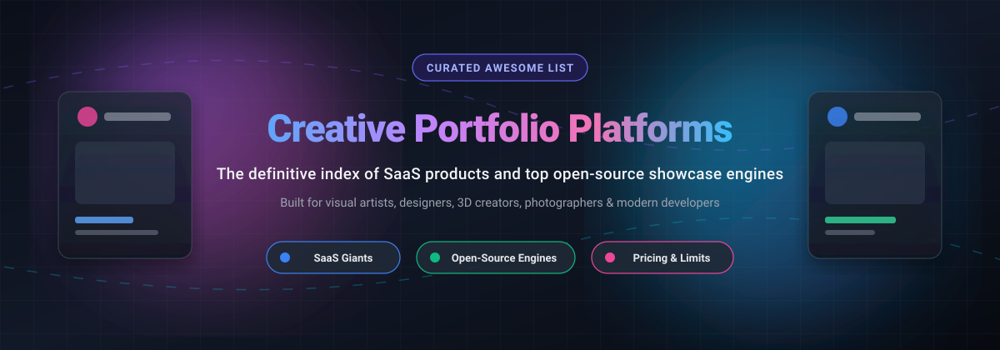

  

# 🎨 Awesome Creative Portfolio Platform 🚀

**A curated index of top-tier SaaS solutions and high-performance open-source portfolio platforms, showcase engines, and templates.**

  
  
  
  
  

  <em>Discover, compare, and deploy world-class visual portfolios, designer showcases, 3D gallery engines, and artist portals.</em>

---

## 📑 Table of Contents
- [🌐 Sector Overview & Market Dynamics](#-sector-overview--market-dynamics)
- [💼 SaaS & Hosted Creative Portfolio Platforms](#-saas--hosted-creative-portfolio-platforms)
- [💻 Open-Source Portfolio Engines & Showcase Templates](#-open-source-portfolio-engines--showcase-templates)
- [🔍 SEO & Selection Strategy for Creators](#-seo--selection-strategy-for-creators)
- [🤝 How to Contribute](#-how-to-contribute)
- [💖 Support & Sponsorship](#-support--sponsorship)
- [📈 Star History](#-star-history)
- [📄 Disclaimer](#-disclaimer)

---

## 🌐 Sector Overview & Market Dynamics

The global portfolio website builders and creative showcase software market was estimated at approximately **$3.8 billion to $4.5 billion in 2025–2026** (projected to reach over $7.2 billion by 2032 with an 8.6% CAGR), driven by the surging creator economy, remote freelance globalization, and visual-first hiring. 

The sector exhibits **moderate fragmentation with high concentration at the discovery tier**: massive corporate conglomerates (notably Adobe and Epic Games) dominate professional creator networks and discovery hubs through high network effects, while a dynamic, highly fragmented long-tail of specialized visual builders (Cargo, Format, Fabrik, Carbonmade) and self-hosted open-source stacks satisfy demanding art directors, engineers, and independent studios seeking total design autonomy and custom domain performance.

---

## 💼 SaaS & Hosted Creative Portfolio Platforms

Below is a detailed comparison of market leaders ranked by corporate size (valuation / annual revenue). All plans, pricing tiers, and exact free limits are outlined below:

| 🏢 Platform | 💰 Starting Tier Price | 🎁 Free Tier / Free Trial Limits | 📊 Company Size (Valuation / Revenue) | 🎯 Core Focus & Features |
| :--- | :--- | :--- | :--- | :--- |
| **[Adobe Behance](https://www.behance.net/)** | $9.99/mo (Behance Pro standalone) or included in Creative Cloud ($59.99/mo) | 100% Free Forever tier: unlimited project publishing, community discovery, job boards, moodboards, and activity feeds. Pro tier adds 0% platform fees on digital sales, custom portfolio domains, project analytics, and search priority. | $215B+ Market Cap (~$21.5B+ annual revenue, Adobe Inc.) | 🌐 Global creative social network and portfolio platform with community feedback, hiring boards, and Adobe CC integration. |
| **[Adobe Portfolio](https://portfolio.adobe.com/)** | $9.99/mo (via Adobe Photography Plan) or included in all Creative Cloud plans ($59.99/mo) | Included at no added fee with any paid Adobe Creative Cloud subscription. Standalone non-subscribers can build and preview up to 5 full sites for free, but publishing live to web requires an active Creative Cloud plan ($9.99/mo+). | $215B+ Market Cap (~$21.5B+ annual revenue, Adobe Inc.) | 🖼️ Seamlessly syncs with Adobe Behance and Lightroom to instantly publish up to 5 custom domain portfolio sites with zero coding. |
| **[ArtStation](https://www.artstation.com/)** | $11.95/mo (Plus Plan) or $18.95/mo (Pro Plan) | 100% Free Forever tier: create a portfolio gallery, post artwork, participate in community challenges, sell on marketplace (12% commission). Paid plans unlock custom 4K galleries, personal domain hosting, password protection, and 5% marketplace commission. | ~$32B Valuation (~$6B+ annual revenue, parent Epic Games) | 🎮 The industry standard for game development, 3D modeling, VFX, entertainment concept art, and game-studio recruiting. |
| **[DeviantArt](https://www.deviantart.com/)** | $3.95/mo (Core) or $7.95/mo (Core+) | 100% Free Forever tier: unlimited artwork uploads, gallery management, community interactions, and basic shop capabilities. Core tiers offer 20% commission reductions, premium badge distribution, and 50GB–500GB cloud storage. | ~$800M+ Valuation (~$1.5B annual revenue, parent Wix.com) | 🎨 Established artist community for illustrators, digital painters, and comic artists with digital asset sales and subscription tiers. |
| **[Dribbble](https://dribbble.com/)** | $8.00/mo (billed annually as Dribbble Pro) | Free Forever account: browse, bookmark, curate collections, and apply to basic jobs. Publishing "Shots" and portfolio showcases requires Dribbble Pro ($8/mo), which includes custom portfolio generation, hiring profiles, and video uploads. | ~$300M–$400M Valuation (Estimated $40M–$60M annual revenue, Tiny Capital) | 🏀 Premier showcase and community platform for UI/UX designers, typographers, illustrators, and agency design teams. |
| **[Cargo Collective](https://cargo.site/)** | $14.00/mo or $99.00/year | Free Forever building and staging mode: full access to Cargo 3 site editor, all typography tools, and templating. Publishing a site live to a public URL or custom domain requires an active $14/mo or $99/yr subscription. | ~$20M–$40M Valuation (Estimated $5M–$10M annual revenue, Independent) | 📐 Avant-garde, design-first CMS favored by artistic directors, typographers, fashion designers, and experimental creators. |
| **[Format](https://www.format.com/)** | $8.00/mo (Basic plan, billed annually) | 14-day full-featured free trial (no credit card required) with access to all portfolio themes, client proofing galleries, and mobile previews. Paid plans scale from $8/mo (100 images, 3 pages) to $15/mo (unlimited images). | ~$25M–$35M Valuation (Acquired by Zenfolio, estimated $6M–$12M annual revenue) | 📸 Photography and visual design portfolio platform with integrated client proofing workflows, print labs, and store options. |
| **[Carbonmade](https://carbonmade.com/)** | $9.00/mo (Beginner plan, billed annually) | Unlimited free trial without time restriction: full access to drag-and-drop builder, 4K video uploads, layout blocks, and styling. Upgrading to $9/mo Beginner (up to 8 projects) or $12/mo Pro (unlimited) is required to publish live. | ~$10M–$20M Valuation (Estimated $3M–$6M annual revenue, Independent) | ⚡ Frictionless, zero-maintenance portfolio builder crafted specifically for illustrators, copywriters, and motion designers. |
| **[Coroflot](https://www.coroflot.com/)** | Free for talent showcase; Employer job postings start at $295/listing | 100% Free Forever tier for creators: unlimited project uploads, case study creation, community visibility, salary surveys, and profile indexing for design recruiters. Monikered by paid job postings for companies. | ~$10M–$15M Valuation (Estimated $2M–$5M annual revenue, Core77) | 🛠️ Professional portfolio hub and high-intent job directory specialized in industrial design, 3D product design, and architecture. |
| **[Fabrik](https://fabrik.io/)** | $11.00/mo (£9/mo or $110/yr, billed annually) | 14-day fully featured free trial (no credit card required) including all media connectors (Vimeo, YouTube, SoundCloud), adaptive themes, and smart styling. Post-trial plans start at $11/mo (50 projects, 100 blog posts). | ~$5M–$10M Valuation (Estimated $1M–$3M annual revenue, Independent UK) | 🎬 Clean, responsive portfolio builder designed for filmmakers, animators, digital artists, creative directors, and boutique agencies. |

---

## 💻 Open-Source Portfolio Engines & Showcase Templates

Looking for complete ownership, zero recurring subscription fees, and total customization? These open-source repositories and template frameworks can be self-hosted on GitHub Pages, Vercel, Netlify, or custom VPS servers.

Repositories are ranked in descending order by **GitHub Stargazers**:

| 🌟 Stargazers | 📦 Project Name | 🛠️ Tech Stack | 💡 Key Highlights & Purpose |
| :---: | :--- | :--- | :--- |
|  | **[cobiwave/simplefolio](https://github.com/cobiwave/simplefolio)** | HTML5, Sass, JavaScript | ⚡ Minimal, clean, and ultra-fast developer and designer portfolio template featuring smooth animations and modern layout. |
|  | **[codewithsadee/vcard-personal-portfolio](https://github.com/codewithsadee/vcard-personal-portfolio)** | HTML, CSS, JavaScript | 🪪 Fully responsive personal vCard and portfolio website with interactive tabs, project modals, and blog showcase. |
|  | **[adrianhajdin/project_3D_developer_portfolio](https://github.com/adrianhajdin/project_3D_developer_portfolio)** | React, Three.js, Tailwind CSS | 🎮 Stunning 3D interactive portfolio utilizing Three.js computer models, floating islands, dynamic lighting, and particle effects. |
|  | **[saadpasta/developerFolio](https://github.com/saadpasta/developerFolio)** | React.js, GraphQL, SCSS | 🚀 Highly customizable single-page portfolio template for creatives and software developers with dark mode and GitHub API sync. |
|  | **[soumyajit4419/Portfolio](https://github.com/soumyajit4419/Portfolio)** | React.js, Node.js, CSS3 | 💻 Modern responsive portfolio web application featuring interactive project cards, resume viewer, and animated sections. |
|  | **[Evavic44/portfolio-ideas](https://github.com/Evavic44/portfolio-ideas)** | Markdown, Awesome List | 💜 Curated anthology of world-class portfolio website ideas, live creative inspirations, and case-study UX patterns. |
|  | **[RyanFitzgerald/devportfolio](https://github.com/RyanFitzgerald/devportfolio)** | Astro, Tailwind CSS, TypeScript | 🎯 Ultra-lightweight, SEO-optimized minimalist portfolio template with lightning-fast lighthouse scores. |
|  | **[ashutosh1919/masterPortfolio](https://github.com/ashutosh1919/masterPortfolio)** | React.js, Lottie Animations | 🔥 Complete customizable showcase with animated illustrations, splash screens, work experience timeline, and project tabs. |
|  | **[rammcodes/Dopefolio](https://github.com/rammcodes/Dopefolio)** | HTML5, CSS3, JavaScript | 🚀 Fast, high-conversion multi-page portfolio template built for creatives, consultants, and frontend designers. |
|  | **[coderjojo/creative-profile-readme](https://github.com/coderjojo/creative-profile-readme)** | Markdown, SVG Graphics | 🎨 Inspiring collection of dynamic GitHub profile READMEs and visual identity showcases for creatives. |
|  | **[iRaul/creative-portfolios](https://github.com/iRaul/creative-portfolios)** | Curated Directory | 🌀 Handpicked directory of breathtaking portfolios built by digital artists, design studios, and interactive art directors. |
|  | **[smaranjitghose/awesome-portfolio-websites](https://github.com/smaranjitghose/awesome-portfolio-websites)** | Multi-framework Templates | 📚 Community-maintained repository of personal portfolio templates for visual artists, researchers, and designers. |
|  | **[arifszn/gitprofile](https://github.com/arifszn/gitprofile)** | React.js, Tailwind CSS, DaisyUI | 🤖 Automatic portfolio generator that fetches and presents projects, stars, skills, and experience straight from your GitHub handle. |
|  | **[itsnitinr/vscode-portfolio](https://github.com/itsnitinr/vscode-portfolio)** | Next.js, CSS Modules | 🖥️ Interactive VS Code-themed portfolio website with functional tabs, theme toggle, and terminal output. |
|  | **[andyzg/gallery](https://github.com/andyzg/gallery)** | Pure HTML, CSS | 📷 Lightweight zero-dependency visual gallery generator for photographers and mockup portfolios hosted on GitHub Pages. |
|  | **[aker-dev/microfolio](https://github.com/aker-dev/microfolio)** | SvelteKit 2, Tailwind CSS 4 | 📱 File-based CMS static portfolio generator supporting interactive grid, list, and geo-map views for architects and artists. |
|  | **[Oustro/portfoliwoah](https://github.com/Oustro/portfoliwoah)** | Next.js, TypeScript, PostgreSQL | 🌐 Community-driven social platform to share case studies, exchange design feedback, and discover fellow creators. |
|  | **[jezzlucena/slatefolio](https://github.com/jezzlucena/slatefolio)** | Next.js, Docker, CMS | 🗄️ Self-hosted full-stack creative portfolio platform with integrated admin dashboard and multi-language support. |
|  | **[eyeinthesky6/artistpass](https://github.com/eyeinthesky6/artistpass)** | HTML5, Tailwind CSS, Vercel | 🎭 Specialized open-source portfolio template for actors and performers with showreels, headshots, and casting cards. |

---

## 🔍 SEO & Selection Strategy for Creators

When building or choosing a creative portfolio platform in 2026, consider these essential technical and discoverability pillars:

1. **Core Web Vitals & Image Optimization**: Visual portfolios are asset-heavy. Ensure WebP/AVIF formatting, responsive srcset generation, and lazy-loading to rank high on Google Images and maintain sub-second page loads.
2. **Open Graph & Rich Snippets**: Implement `og:image` tags with 1200x630px cards to ensure previews look striking when shared on X/Twitter, LinkedIn, Discord, and Slack.
3. **Hybrid Architecture (The Dual-Funnel Approach)**:
   - **Discovery Funnel**: Publish project snapshots on high-authority platforms (**Behance**, **ArtStation**, **Dribbble**) for algorithm-driven client discovery.
   - **Conversion & Identity Funnel**: Direct serious inbound prospects to your owned, custom-domain website (**Cargo**, **Format**, or an open-source static site like **microfolio** / **simplefolio**) for complete branding and zero distraction.

---

## 🤝 How to Contribute

We welcome contributions from designers, creative engineers, and open-source creators! 

1. **Fork the repository** to your GitHub account.
2. **Add or refine an entry** in `README.md` following the exact table structure.
3. **Verify criteria**:
   - For SaaS: Must include verified starter pricing, specific free tier/trial boundaries, and company valuation/revenue metrics.
   - For Open-Source: Must include a live GitHub link, valid Stars_Badge, tech stack details, and clear creative/showcase utility.
4. **Submit a pull request** with a concise description of why the tool deserves inclusion.

---

## 💖 Support & Sponsorship

If this curated repository helped you build your dream portfolio or discover the right platform for your creative career, please consider showing your support! 🌟

- ⭐ **Star this repository** to help others discover it across GitHub.
- 🍴 **Fork and share** with your fellow designers, developers, and artist communities.
- ☕ **Buy me a coffee / Sponsor the project**: Contributions help maintain active research, benchmark new platforms, and keep documentation up to date. You can support directly via the [GitHub Sponsor Dashboard](https://github.com/sponsors/ishandutta2007). Thank you for being part of this creative ecosystem! ❤️

---

## 📈 Star History

---

## 📄 Disclaimer

*All product names, logos, trademarks, and registered trademarks mentioned are property of their respective owners. Company valuations and annual revenue metrics are estimated from public SEC filings, venture funding rounds, and reputable business intelligence databases. Pricing figures reflect published standalone tiers as of 2026 and are subject to change by respective vendors.*
